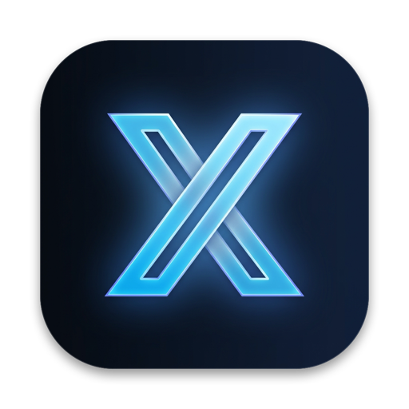

# XNC — XNC is not Chrome



**XNC** is a super-lightweight (<5 MB native binary, well under 20–30 MB), Chromium-free desktop web browser built with native OS UI toolkits and system web engines:

- **macOS:** Swift + AppKit + `WKWebView` (clickable `NSToolbar` unified compact titlebar tabs + `.underWindowBackground` vibrancy blur)
- **Linux:** C++20 + GTK3 `GtkHeaderBar` + `WebKit2GTK 4.1`
- **Windows:** C++20 + Win32 + `WebView2` + Windows 11 Mica backdrop (`DwmSetWindowAttribute`)

## Quick Install

### Windows (`XNC-Setup.exe` — No Admin / No UAC / No Build Tools)

- **Installer:** Download and run [`XNC-Setup.exe`](https://github.com/Mandrusian/XNC/releases/latest/download/XNC-Setup.exe) from GitHub Releases (installs per-user to `%LOCALAPPDATA%\Programs\XNC`, zero admin rights or UAC prompt required).
- **PowerShell one-liner (no admin, no build tools):**
  ```powershell
  irm https://raw.githubusercontent.com/Mandrusian/XNC/main/scripts/install-windows.ps1 | iex
  ```
- **Portable zip:** [`XNC-windows-x64.zip`](https://github.com/Mandrusian/XNC/releases/latest/download/XNC-windows-x64.zip)

### macOS (`Applications/XNC.app`)

From GitHub directly:

```bash
curl -fsSL https://raw.githubusercontent.com/Mandrusian/XNC/main/scripts/install-macos.sh | bash
```

Or download [`XNC-macos-arm64.zip`](https://github.com/Mandrusian/XNC/releases/latest/download/XNC-macos-arm64.zip) from Releases, or install from a local clone:

```bash
./scripts/install-macos.sh
```

### Linux (`~/.local/bin/xnc` + desktop launcher)

Requires `cmake`, `pkg-config`, `libgtk-3-dev`, and `libwebkit2gtk-4.1-dev` (or grab [`XNC-linux-x64.tar.gz`](https://github.com/Mandrusian/XNC/releases/latest/download/XNC-linux-x64.tar.gz) from Releases):

```bash
curl -fsSL https://raw.githubusercontent.com/Mandrusian/XNC/main/scripts/install-linux.sh | bash
```

Or from a local clone:

```bash
./scripts/install-linux.sh
```

## Features

- **Custom SearXNG Support (`Cmd+,` on macOS / `☰` menu everywhere):** Point XNC at any self-hosted or public SearXNG instance (e.g., `https://searx.example.com`, `http://localhost:8080`, or custom `{query}` template), or fall back to DuckDuckGo anytime.
- **Transparent Mica Websites Toggle (`Cmd+Shift+M` / `Ctrl+Shift+M`):** Zen-browser-style glass toggle that strips solid web backgrounds (`drawsBackground = false` + cosmetic CSS) so native OS vibrancy/Mica shines right through websites.
- **uBlock-Style Shield:** Network-level third-party ad/tracker domain blocking (`64` high-impact domains), cosmetic CSS element hiding (`shared/cosmetic_rules.css`), and per-site Pause/Resume allowlisting.
- **Interactive Element Zapper (`Zap` / `Cmd+Shift+Z` / `Ctrl+Shift+Z`):** Hover over page elements, **Click** to remove immediately (`U` to undo, `Esc` to exit), or **Shift+Click** to permanently hide the selector for that host.
- **Developer Tools (`Dev` button & `Develop` menu):** Web Inspector / DevTools (`Cmd+Opt+I`, `Ctrl+Shift+I`, `F12`), JavaScript Console (`Cmd+Opt+J`), View Page Source (`Cmd+Opt+U`), per-tab JavaScript toggle, User-Agent presets (macOS), and Clear Cookies/Cache.
- **Multi-Tab + Private Tabs:** Isolated ephemeral/in-private tabs excluded from local history.

## Keyboard Shortcuts

| Action | macOS | Linux / Windows |
| --- | --- | --- |
| New Tab / Private Tab | `Cmd+T` / `Cmd+Shift+N` | `Ctrl+T` / `Ctrl+Shift+N` |
| Close Tab | `Cmd+W` | `Ctrl+W` |
| Focus Address Bar | `Cmd+L` | `Ctrl+L` |
| Reload / Stop | `Cmd+R` | `Ctrl+R` |
| Back / Forward | `Cmd+[` / `Cmd+]` | `Alt+Left` / `Alt+Right` |
| Bookmark Page | `Cmd+D` | `Ctrl+D` |
| Configure Custom SearXNG | `Cmd+,` | `☰` menu |
| Toggle uBlock Shield | `Cmd+Shift+B` | `Ctrl+Shift+B` |
| Element Zapper | `Cmd+Shift+Z` | `Ctrl+Shift+Z` |
| Transparent Mica Websites | `Cmd+Shift+M` | `Ctrl+Shift+M` |
| Web Inspector / Console / Source | `Cmd+Opt+I` / `J` / `U` | `Ctrl+Shift+I` or `F12` |

## Build & Run Manually

### Shared C++20 Core Tests (all platforms)

```bash
cmake -S core -B core/build -DCMAKE_BUILD_TYPE=Release
cmake --build core/build
ctest --test-dir core/build --output-on-failure
```

### macOS (`macos/`)

```bash
cd macos
swift test
./scripts/package_app.sh
open dist/XNC.app
```

### Linux (`linux/`)

```bash
cmake -S linux -B linux/build -DCMAKE_BUILD_TYPE=Release
cmake --build linux/build
./linux/build/xnc
```

### Windows (`windows/`)

```powershell
nuget install Microsoft.Web.WebView2 -OutputDirectory windows/packages -ExcludeVersion
cmake -S windows -B windows/build
cmake --build windows/build --config Release
.\windows\build\Release\xnc.exe
```
